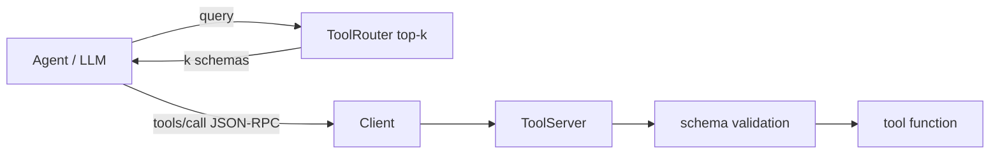

# Toolbelt - an MCP-style tool server, client and router

Modern AI agents act through **tools**. Toolbelt is a small, readable implementation of the plumbing behind that idea: a
**JSON-RPC 2.0 tool server** (the same shape as the Model Context Protocol: `initialize`, `tools/list`, `tools/call`), a client that talks to it over stdio, and a
**router** that chooses which tools to show a model when you have far too many to fit in a prompt.

```text
tools: add, word_count, slugify, sha256, days_between, convert_units, extract_emails
add(2, 3.5)            -> 5.5
convert_units(100,c,f) -> 212.0
bad call               -> [-32602] arguments.a: expected number, got str
router: 'convert 5 miles to kilometers' -> ['convert_units'] (saves 77% of schema size)
```
(real output of `Client.spawn()` starting `python -m toolbelt.examples` as a subprocess)

## Components
| File | What it does |
| --- | --- |
| `server.py` | `@server.tool` turns a typed function into a tool: **JSON schema from type hints** (`Literal` -> enum, `list[str]` -> array, defaults -> optional). Standard error codes (-32700 parse, -32600 invalid request, -32601 no method, -32602 invalid params, -32000 tool error); notifications get no reply; a buggy tool never crashes the server. |
| `validation.py` | From-scratch JSON-Schema subset validator (`type`, `required`, `enum`, `minimum/maximum`, `items`, `properties`, `additionalProperties`). Arguments are validated **before** the tool runs, with path-aware messages the model can act on. |
| `client.py` | `Client.spawn()` (real subprocess over newline-delimited JSON) or `Client.in_process(server)`; errors surface as `RpcError` with the code. |
| `router.py` | BM25 over tool name, description and parameter names with a small synonym map (`hash` -> `sha256`, `miles` -> `convert_units`). Send the model only the top-k schemas - the demo above saves 77% of the schema size for one query. |
| `examples.py` | Seven example tools; run it directly as a server. |



## Write your own server
```python
from toolbelt.server import ToolServer
srv = ToolServer("my-tools")

@srv.tool
def lookup_order(order_id: int, include_items: bool = False) -> dict:
    """Fetch an order by id."""
    ...

srv.serve_stdio()      # speaks JSON-RPC on stdin/stdout
```

```bash
python -m unittest discover -s tests -t . -v      # 9 tests incl. a real stdio subprocess round-trip; no dependencies
```
This is an educational/compact implementation of the *pattern*, not a drop-in for the official MCP SDK. The original LangChain agent notebook is kept in [`legacy/`](legacy/).
